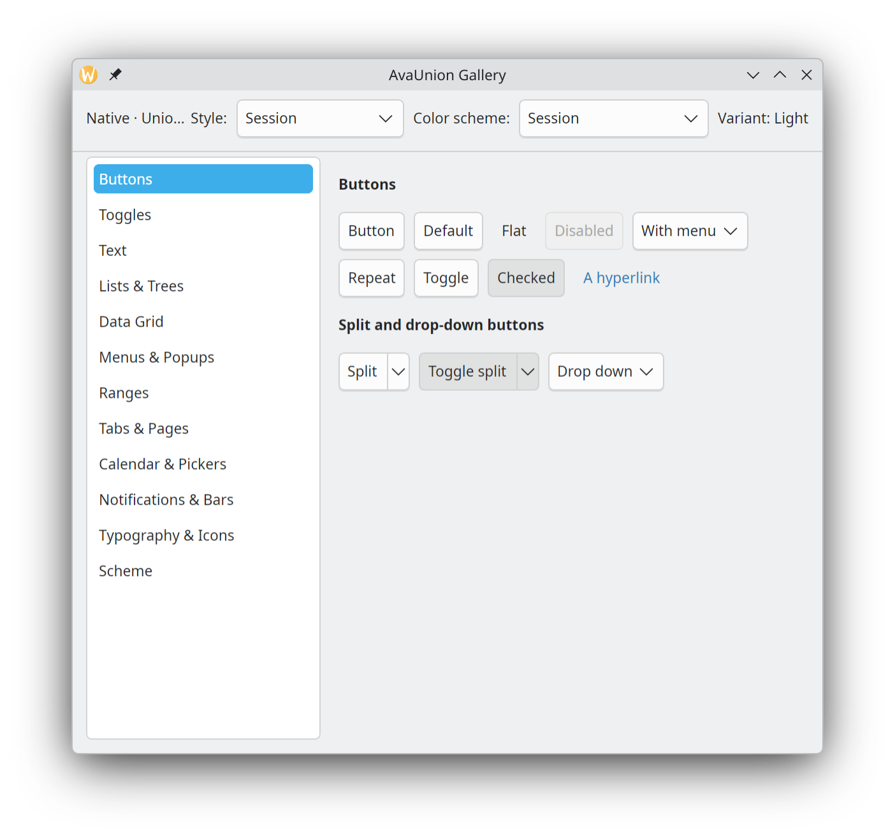

# AvaUnion

[](https://www.nuget.org/packages/AvaUnion.Theme/) 


AvaUnion is an experimental theme for [Avalonia](https://avaloniaui.net) 12 
that binds [KDE Union](https://api.kde.org/union-index.html). When Union is available, 
it will wrap its thems (Including its style, color schemes, fonts, icons, etc) to it dynamically. 
When it's not, it uses a snapshot of breeze taken at build time and bundled with the library.
You can also provide your own for use on other platforms.



To see it live, go to [live gallery demo](https://drasticactions.github.io/AvaUnion),
or download the [AppImage](https://github.com/drasticactions/AvaUnion/actions/workflows/appimage.yml).

## Use

with `xmlns:union="https://github.com/avaunion"`.

```xml
<Application.Styles>
  <union:UnionTheme />
</Application.Styles>
```

```xml
<union:UnionTheme StyleId="breeze" ColorScheme="BreezeDark" Engine="Auto" FollowThemeVariant="True" />
<union:UnionScope StyleId="breeze-mobile"> … </union:UnionScope>
```

```csharp
AppBuilder.Configure<App>()
    .UsePlatformDetect()
    .UseWaylandWithFallback() 
    .WithAvaUnion(new AvaUnionOptions { Engine = UnionEngineKind.Auto })
    .StartWithClassicDesktopLifetime(args);
```

| Option | Meaning |
|---|---|
| `StyleId` | Pins a Union style package (`breeze`, `breeze-rtl`, `breeze-mobile`, or any installed style). Null follows the session's `kdeglobals [KDE] unionStyle`. |
| `ColorScheme` | A color scheme for this application only, like KColorSchemeMenu: a `.colors` path or a scheme name. Null follows the session. The managed engine knows `BreezeLight` and `BreezeDark`. |
| `Engine` | `Auto` (default) picks the native engine when it can, `Native` fails loudly when it can't, `Managed` never loads Qt. `AVAUNION_ENGINE=native\|managed` overrides it. |
| `StylePackages` | Style packages that the application ships for its own use, in addition to the ones found in the entry assembly. See [App styles](#app-styles). |
| `FollowThemeVariant` | With the native engine, sets `Application.RequestedThemeVariant` from the scheme: dark when the window background's relative luminance is below 0.5. With the managed engine the platform's variant picks Breeze Light or Dark. |

For `Avalonia.Controls.DataGrid`, add the `AvaUnion.DataGrid` package and
`<union:UnionDataGridTheme />` after `UnionTheme`. Rows alternate as in Qt
Quick's TableView; `Classes="no-alternating-colors"` on a grid turns that off.

For the controls that Qt Quick Controls, Kirigami and QtWidgets have and
Avalonia does not, add the `AvaUnion.Controls` package and
`<union:UnionControlsTheme />` after `UnionTheme`.

Icons come from the native engine or, with the managed engine on Linux, from
the installed icon theme. Windows, macOS and the browser have no icon theme.
For them, add the `AvaUnion.BreezeIcons` package and call `.WithBreezeIcons()`
on the `AppBuilder`. It holds every Breeze icon, at every size, and on Linux
it fills in names that the installed theme lacks. Without it, a few simple built-in glyphs are drawn instead. The
icons are LGPL-3.0-or-later, so the package is
`LGPL-2.1-only AND LGPL-3.0-or-later`; the other packages stay LGPL-2.1-only.
`tools/update-breeze-icons.sh` packs them from a breeze-icons release, and
`tools/compare-breeze-icons.sh` compares how AvaUnion draws each one with
QtSvg, resvg or rsvg.

Classes are Union hints: `<Button Classes="flat" />` matches Breeze's
`button.flat`. `union:Union.Hints`, `union:Union.Id` and
`union:Union.Attributes` add more. `docs/theme-authoring.md` describes the
element model and how to write a ControlTheme with `{union:Style}`.

## App styles

An application can ship its own Union style package. Add the folder and its
snapshot to the project file:

```xml
<UnionStylePackage Include="Styles/mystyle" Snapshot="Styles/mystyle.union.bin" />
```

This can be used for using a union theme on platforms not running it.

## Packages

| Package | Contents |
|---|---|
| `AvaUnion.Theme` | The engines, the Breeze snapshot, the native binding, the element model, `UnionBox`, `UnionPositioner`, `UnionIcon`, and ControlThemes. |
| `AvaUnion.Native` | Runtime only: `libavaunion-native-<union-version>.so` for linux-x64 and linux-arm64. `AvaUnion.Theme` depends on it. |
| `AvaUnion.DataGrid` | ControlThemes for `Avalonia.Controls.DataGrid`: add `<union:UnionDataGridTheme />` after `UnionTheme`. |
| `AvaUnion.Controls` | Controls that Avalonia lacks, with Union ControlThemes: add `<union:UnionControlsTheme />` after `UnionTheme`. |
| `AvaUnion.BreezeIcons` | Every Breeze icon, for Windows, macOS and the browser: call `.WithBreezeIcons()`. LGPL-2.1-only AND LGPL-3.0-or-later. |

## Building

```sh
dotnet build AvaUnion.slnx           # libraries and tests
dotnet build AvaUnion.Samples.slnx   # plus the gallery (desktop and browser)
dotnet run --project tests/AvaUnion.Theme.Tests
```

To build the shim, run `tools/natives/build-union.sh`.

The shim needs Qt 6, KF6 Config and IconThemes, and
Union's source tree in the `external/union` submodule.

```sh
git submodule update --init
cmake -S native -B native/build
cmake --build native/build
tools/regenerate-data.sh    # snapshot, parity corpus and expected results
tools/publish-local.sh      # pack everything into the local NuGet cache
```

## LLM Usage

LLMs were/are used in the construction of the generator tooling, CI, samples, and portions of the documentation.

## License

LGPL-2.1-only. See `LICENSE` and `NOTICE.md`.
