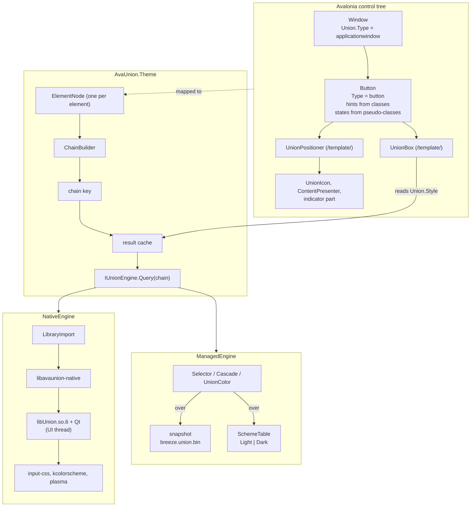

# Architecture

AvaUnion asks KDE Union how every control should look 
and draws and lays it out in Avalonia.

## Engines

`IUnionEngine` has two implementations.

- **NativeEngine** binds union through `libavaunion-native`, a flat
  C ABI (`native/src/avaunion.h`) over `StyleRegistry`, `Style`, `Element`,
  `ElementQuery`, `ColorProvider` and `PlatformPlugin`. Qt runs on the
  Avalonia UI thread; the shim creates or adopts the `QGuiApplication` with the
  `offscreen` QPA and the KDE platform theme, and forces Union's Plasma
  platform plugin in Plasma sessions. Results cross the ABI as `avu_resolved`,
  a blittable struct with a presence bit per leaf and colors resolved to ARGB.
- **ManagedEngine** ports Union's selector matching, cascade and color
  operations to C# and runs over a snapshot exported from the real Union at
  build time: the rules of `breeze`, `breeze-rtl` and `breeze-mobile` with
  symbolic colors, and Breeze Light and Dark resolved through KColorScheme.

Both engines also take the application's own style packages
(`UnionStylePackage`, `docs/app-styles.md`). The native engine loads each one
from its folder with `avu_style_from_package`. Union parses it, but it is not
added to Union's `StyleRegistry`. The managed engine loads the package's
snapshot. An app package has priority over an installed style with the same
id, also when that id is the session default.

A snapshot starts with the hash of Union's property schema. Each style in it
carries the text of its `metadata.json`. A snapshot with another schema hash
is refused. `union-export` writes the metadata into each export, and lists
the paths that a style refers to outside its package. For an app package it
also lists the CSS variables that an installed style defines too, because
Union's CSS parser keeps the first definition of a variable for the whole
process.

`EngineSelector` picks once per process: `AVAUNION_ENGINE`, then the theme's
`Engine`, and for `Auto` native when a shim has the property schema of the
installed Union, starts cleanly and the default style parsed without errors.

## Generated code

`tools/union-properties` reads Union's `properties.yml` and writes both sides
of the boundary: the `ResolvedStyle` records, the leaf table, `avu_resolved`
in C and C#, the visitor and copy over `StylePropertyGroup`, and the
`{union:Style}` path table. The generated header carries the schema hash and
the Union tag; a test checks it against `native/cmake/UnionSource.cmake`.

## Elements and chains

`Union.Type` makes an element a Union element. An `ElementNode` mirrors it:

- **type, id** from the attached properties;
- **states** from the pseudo-classes of the state source (`StateMapper`):
  the element itself for templated controls, the templated parent for other
  parts, or none;
- **hints** from the element's classes, `Union.Hints`, automatic hints
  (`AutoHints`, e.g. `inside-list`, `with-menu`, `inactive`) and state hints
  (`indeterminate`, `menu-open`, `expanded`);
- **attributes** from `Union.Attributes`, `Union.ColorSet` and automatic ones
  (`display`, `direction`, `type`).

The chain is the root-first list of typed visual ancestors. A popup root is
untyped and ends the walk; the chain continues at the owning window's root
element, as Qt Quick attaches popups. So `popup.combobox` is never a
descendant of `combobox`.

## Invalidation

Avalonia applies a ControlTheme's setters once, so no ControlTheme is rebuilt
at runtime. Everything dynamic flows through:

1. the inherited `Union.Style` property, which each node sets to its
   resolved style and which `{union:Style}` bindings read;
2. `UnionResourceProvider` and `DynamicResource`, for scheme colors, fonts and
   animation settings;
3. `UnionBox`, `UnionPositioner` and `UnionIcon`, which re-render or re-measure
   when `Union.Style` changes.

A change to a node's description marks its subtree dirty; dirty nodes resolve
in one dispatcher pass, and a result equal to the previous one invalidates
nothing. A color change reuses each node's chain and cache key.

`Union.Style` holds a `UnionStyleSlot`, one per node. When a node's new
result differs from the old one only in colors (a scheme change, a hover),
the node updates its slot in place and raises `ColorsChanged` instead of
setting a new value, so Avalonia carries nothing through the elements below.
Only what draws colors reacts: `UnionBox` and `UnionIcon` repaint, and a
`{union:Style}` binding whose leaf is a color recolors its brush. Those
brushes are mutable and shared by the bindings of one path on elements with
the same style, so a scheme change recolors each once. Bindings to sizes,
alignments and fonts are not even told. Results are interned, so equal
results are one `ResolvedEntry` and comparing them is a reference check.

With 2,000 elements a scheme change takes about 3 ms (`PerformanceTests`). Colors and style changes from the session bump the engine epoch,
clear the result cache and re-resolve every live node.

## Drawing and layout

`UnionBox` draws one element's style the way Union's `StyledRectangle` does:
the shadow, the background color, the background image (geometry from the
snapshot, or a raster from the shim), then the border inside and the outline
outside the bounds as rings with per-side colors.

Union's shadow shader fades as `1 − smoothstep(−blur, blur, d)` across the
edge of the spread-grown rect. `UnionBox` draws it as an Avalonia
`BoxShadow` whose Gaussian has σ = 0.47·blur, which stays within 2/255 of
Union for Breeze's menu, popup, tooltip and dialog shadows
(`ShadowCalibrationTests`), so no precomputed falloff is needed.

A popup's surface ends at its content, and neither X11 nor Wayland draws a
shadow for it (Avalonia's `WindowManagerAddShadowHint` does nothing on
Linux), so AvaUnion draws Breeze's popup shadows itself. When the element
that is a popup's content resolves a shadow, `PopupShadowSpace` gives that
content a margin as large as the shadow. Avalonia passes a popup child's
margin to the positioner as `Deflate`: the content, not the margin, is
placed and kept on screen, so flipped popups stay against their anchor, and
on Wayland the margin falls outside the popup's window geometry. A press in
the margin closes a light-dismiss popup, as a press outside it would.

`UnionPositioner` runs a statement-by-statement port of Union's positioner:
item, content and background containers, each with start, center, end and
fill buckets, placed from the `icon`, `text` and `layout` alignments.
Union's own positioner fixtures run as tests.

## Qt next to GTK

The native engine runs Qt on the Avalonia UI thread, and Avalonia's X11
backend can show GTK file dialogs in the same process. Both pump modes work
with a GTK dialog open. AvaUnion's timer and Avalonia's GLib main loop with
`HostRunsGLibMainLoop` both deliver color scheme changes while the dialog is
open, and the process exits cleanly after the dialog closes.

